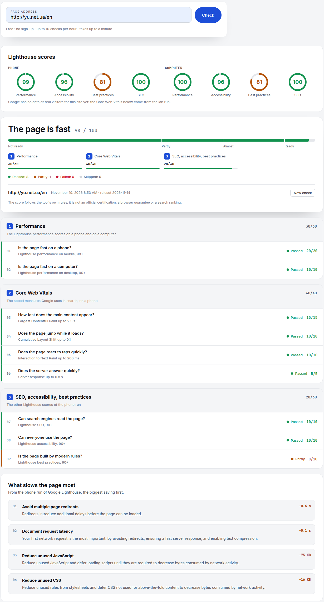

# Page Speed

[](LICENSE)
[](composer.json)
[](composer.json)
[](composer.json)
[](https://yu.net.ua/en/tools/page-speed)

A Livewire tool for Laravel that checks a page's speed and Core Web Vitals through the Google PageSpeed Insights API. It runs Lighthouse for a phone and a computer at the same time, turns the scores into a plain-language checklist, and lists the issues that would save the most loading time.



**🔗 Live example: [yu.net.ua/en/tools/page-speed](https://yu.net.ua/en/tools/page-speed)**

## What it checks

9 checks in three groups. The result is a score out of 100 and a verdict.

| Group | Checks |
|---|---|
| **Performance** | Lighthouse performance on a phone and on a computer |
| **Core Web Vitals** (phone) | LCP (main content appears), CLS (layout shifts), INP / TBT (reaction to taps), TTFB (server response) |
| **SEO, accessibility, best practices** | The other Lighthouse scores of the phone run |

## Requirements

- PHP ^8.4
- Laravel ^13.0
- Livewire ^4.0
- A Google PageSpeed Insights API key

## Installation

```bash
composer require yu-laravel/page-speed
```

This also installs [`yu-laravel/web-tools-core`](https://github.com/yuriyakishin/laravel-web-tools-core). Both service providers are discovered automatically.

Get an API key in Google Cloud Console (APIs & Services → Credentials, with the PageSpeed Insights API enabled) and add it to `.env`:

```
PAGESPEED_API_KEY=...
```

Without a key, the tool stays unavailable.

## Usage

Put the component on a page whose layout includes `@livewireStyles` and `@livewireScripts`:

```blade
<livewire:page-speed />
```

Import the styles into your CSS build:

```css
@import "../../vendor/yu-laravel/web-tools-core/resources/css/web-tools-core.css";
@import "../../vendor/yu-laravel/page-speed/resources/css/page-speed.css";
```

To match your site's colours and fonts, override the `--wt-*` variables (see [Web Tools Core](https://github.com/yuriyakishin/laravel-web-tools-core#styles)).

## Configuration

| Env variable | Default | Description |
|---|---|---|
| `PAGE_SPEED_ENABLED` | `true` | Turn the tool off without uninstalling it. |
| `PAGESPEED_API_KEY` | | Google PageSpeed Insights API key. |
| `PAGE_SPEED_PER_HOUR` | `10` | Checks per visitor IP per hour. |

One Lighthouse run takes 15–40 seconds, so the API timeout is 75 seconds. Lighthouse results vary from run to run, so a report is cached for 10 minutes and a repeated check shows the same numbers. `config/page-speed.php` also sets how many Lighthouse issues to show (8).

## Events

After every check the tool dispatches `Yu\WebToolsCore\Events\ToolCheckedEvent` with `tool = "page-speed"` (see [Listening to checks](https://github.com/yuriyakishin/laravel-web-tools-core#listening-to-checks)).

## Languages

13 translations: cs, de, en, es, fr, it, ja, nl, pl, pt, tr, uk and zh. The language is taken from the visitor's browser, with your app locale as the fallback.

## Author

Yuriy Akishin:
- 🌐 Website: https://yu.net.ua
- 📧 Email: yuriy.akishin@gmail.com
- 💼 LinkedIn: https://www.linkedin.com/in/yuriyakishin/
- 💻 GitHub: https://github.com/yuriyakishin

## License

MIT. See [LICENSE](LICENSE).
